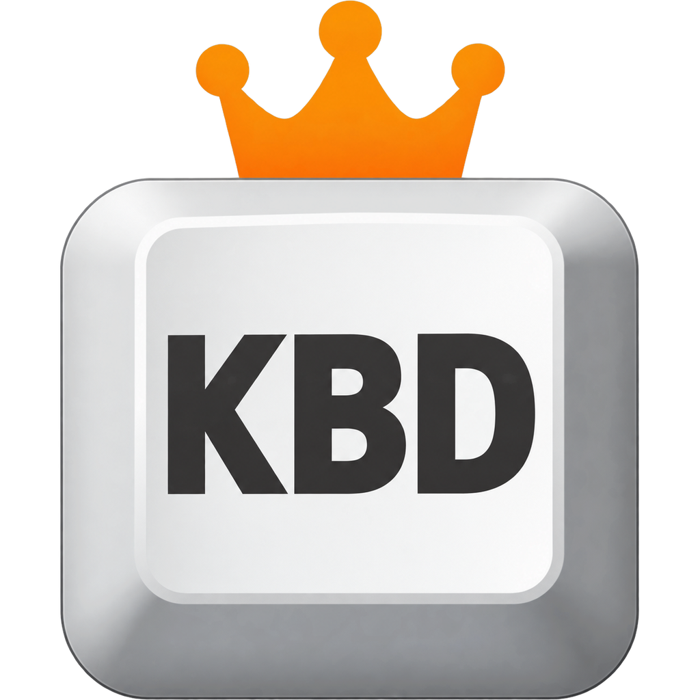
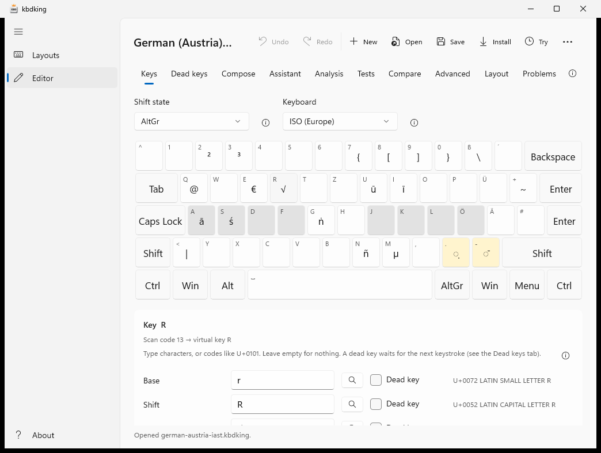
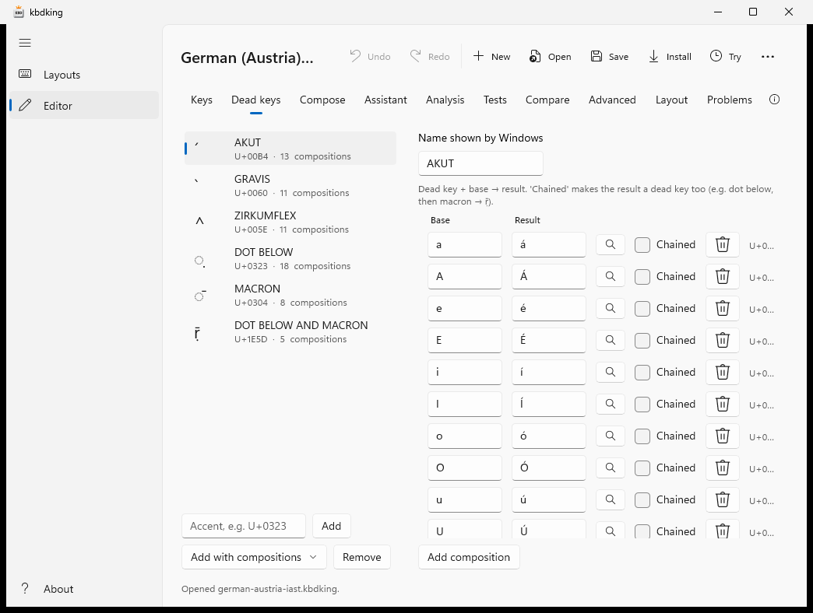
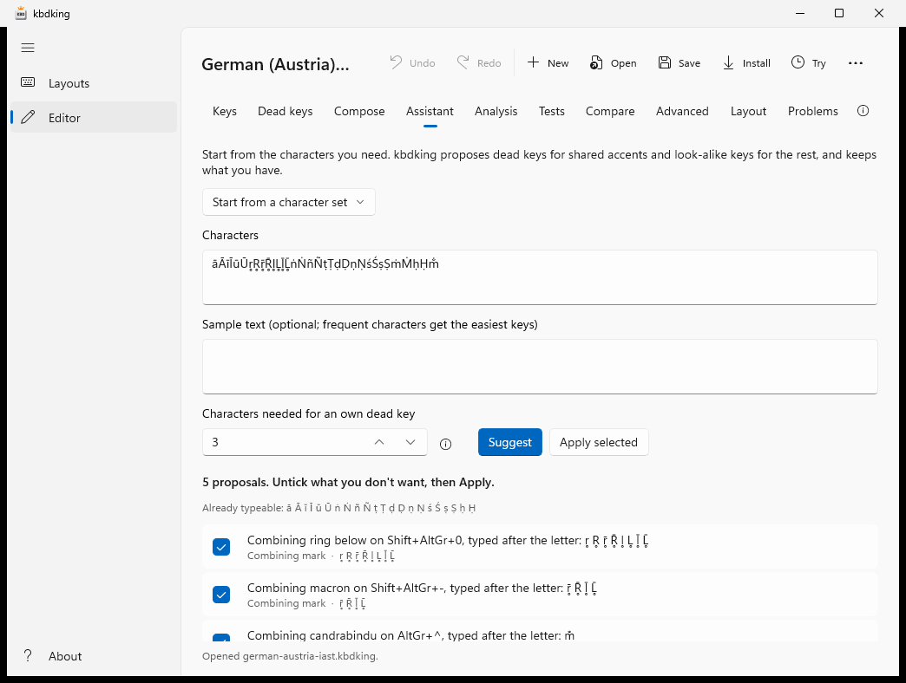
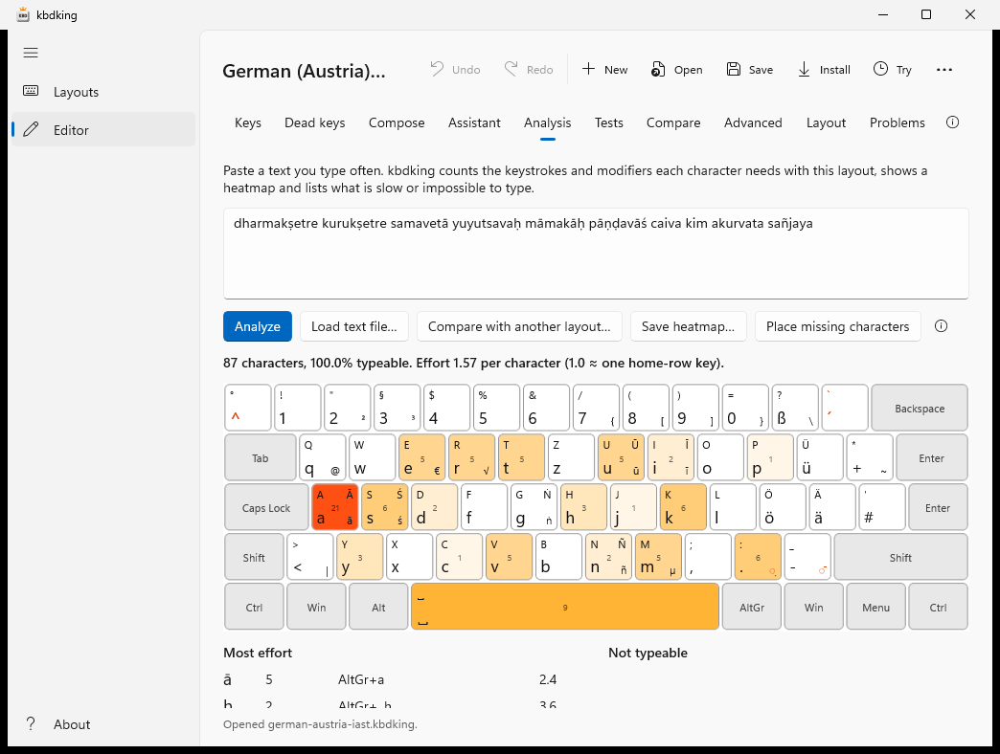
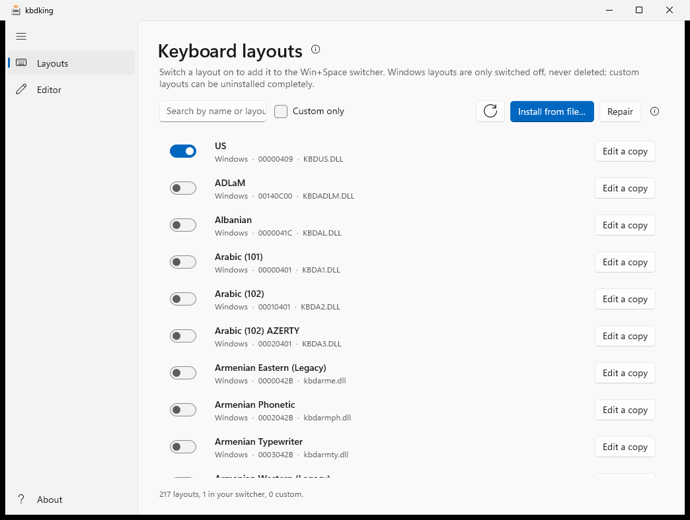

# kbdking

kbdking creates, edits and installs Windows keyboard layouts. It imports an existing layout, lets you
change any key, dead key or ligature, and builds a real Windows layout DLL, so the result works in every
app with nothing running in the background. Free and open source (MIT).

Formerly called *Keyservant*. Installing kbdking replaces an installed Keyservant, layouts installed with it are
kept and managed as before, and old `.keyservant` files open once renamed to `.kbdking`.

> **Status: v0.1, early development.** The engine, file formats, DLL writer and CLI are implemented and
> tested; the Windows app and the installer are first versions that still need testing on real PCs.
> See [Status](#status) before using it on a machine you care about.

## Install

Download the installer from [**Releases**](https://github.com/rorugi/kbdking/releases):
`kbdking-x64.msi` (or `kbdking-arm64.msi` for Windows on ARM) and run it. It installs kbdking for all users,
adds it to the Start menu and puts the `kbdking` command on the PATH; uninstall it in Settings → Apps. The newest
build of `main` is always at [Releases → latest](https://github.com/rorugi/kbdking/releases/tag/latest).
The installer isn't code-signed, so Windows may say it doesn't know the publisher: choose *More info → Run anyway*.

To build the installer yourself: `.\tools\build-installer.ps1` (writes `artifacts\kbdking-x64.msi`).

## A quick tour

**Edit every key** in every shift state. The keyboard shows what each key types (here with AltGr); the light grey
keys are the home row, dead keys are yellow. Pick a key and edit its characters below, or type into the preview box
to try the layout before installing it.



**Dead keys**: an accent key followed by a letter gives the accented letter (dot below + r → ṛ). Chained dead keys
give letters with two accents (dot below + macron + r → ṝ).



**Placement assistant**: enter the characters you need, or pick a set such as Sanskrit, Pinyin or Vietnamese, and
kbdking proposes where to put them, keeping everything the layout already has.



**Text analysis**: paste a text you type often and see how many keystrokes each character needs, as a heatmap.



**Layout manager**: every layout on the PC, the ones in your Win+Space switcher first. Switch them on and off,
install, repair or uninstall your own.



## Features

- **Layout manager**: list every layout on the PC, add or remove it from the Win+Space switcher with a
  toggle, install custom layouts, uninstall them completely, and repair layouts lost in Windows updates.
- **Editor**: on-screen ISO, ANSI, JIS and ABNT keyboards, every shift state (Shift, AltGr, Ctrl, Kana, …)
  with a shift-state manager, dead keys including **chained dead keys**, ligatures (several characters per
  key, including characters outside the BMP) with their own list, Caps Lock behaviour and SGCAPS, key
  names, a low-level scan-code editor, **undo/redo**, and a live preview that types with the layout you
  are editing before you install it.
- **Shortcuts stay in place**: one setting keeps Ctrl+C, Ctrl+V, Ctrl+Z… at their QWERTY (or QWERTZ,
  AZERTY) positions while the keys type Colemak, Dvorak, Neo or your own arrangement.
- **Layer keys**: turn Caps Lock, the < > key, Menu or any other key into an extra Shift that switches to
  a layer of your own (Greek, symbols, IAST…), up to three layers, each also with Shift. Built into the
  layout, no background program.
- **Unicode picker**: find any character by name (“a macron”, “dot below”), by code or by pasting it.
  Works offline (Unicode 15.1 names are built in).
- **Placement assistant**: give it the characters you need (or a sample text) and it proposes dead keys for
  shared accents, look-alike keys for the rest and chained dead keys for double accents, while keeping
  what you already have. Presets for IAST, Pinyin, Vietnamese, Polish and more.
- **Compose key**: sequences like Compose . r → ṛ, compiled into the layout itself (no background
  program). Imports `.XCompose` and WinCompose files.
- **Optimize for real text**: paste a text you type and see the typing effort per character, a heatmap
  and what can't be typed; compare two layouts on the same text.
- **Layout tests**: “AltGr+. t must type ṭ”, saved in the file and checked after every change.
- **Compare**: the differences between two layouts, listed and marked on the keyboard.
- **Test installs**: install a layout for a set time; Windows removes it again automatically, even if
  kbdking is closed, unless you choose *Keep*.
- **Printouts**: keyboard pictures and key stickers (SVG, real size).
- **Formats**: `.kbdking` (readable JSON, diff-friendly), MSKLC `.klc`, Windows layout DLLs, macOS
  `.keylayout`, Linux XKB symbols (plus a `.XCompose` file for dead keys), and C source.
- **Builds without a compiler**: kbdking writes the PE file itself, for x64, ARM64 and the 32-bit WOW64
  DLL that 32-bit apps use. No Visual Studio, WDK or MSKLC needed, and builds are reproducible.
- **Deployment**: a small standalone `setup.exe` for any Windows PC (with an entry in *Apps & features*),
  an MSI for Group Policy and Intune, and a ready-to-wrap Intune Win32 app folder with a detection script.

## Quick start (CLI)

```powershell
kbdking new de-AT -o my-layout.kbdking --name "German + IAST" --dll kbdiast
# edit my-layout.kbdking, or open it in the kbdking app
kbdking validate my-layout.kbdking
kbdking install my-layout.kbdking        # asks for admin rights once
kbdking list --custom
kbdking uninstall A0000C07
```

More commands:

```powershell
kbdking install my-layout.kbdking --temporary 30   # test install, reverts itself after 30 minutes
kbdking keep A0000C07                                 # ...or keep it
kbdking suggest my-layout.kbdking --chars "āīūṛṝḷṅñṭḍṇśṣṃḥ" --apply
kbdking compose import my-layout.kbdking ~/.XCompose
kbdking test my-layout.kbdking
kbdking analyze my-layout.kbdking mytext.txt --heatmap heat.svg --compare other.kbdking
kbdking diff old.kbdking my-layout.kbdking --svg changes.svg
kbdking render my-layout.kbdking -o stickers.svg --stickers
kbdking convert my-layout.kbdking my-layout.keylayout      # macOS; .xkb for Linux
kbdking package my-layout.kbdking --msi my-layout.msi       # needs WiX: dotnet tool install -g wix
kbdking package my-layout.kbdking --intune intune-folder
kbdking unicode a macron
kbdking shortcuts colemak.kbdking qwerty                    # Ctrl+C/V/Z stay at QWERTY positions
kbdking layers my-layout.kbdking add 3A A                  # Caps Lock selects Layer A while held
```

Also: `templates`, `build` (DLLs only), `enable`/`disable` (switcher), `import` (save an installed layout
as a `.kbdking` file) and `repair`. Run `kbdking help` for details.

The sample [`samples/german-austria-iast.kbdking`](samples/german-austria-iast.kbdking) adds IAST
transliteration for Sanskrit to the Austrian German layout: AltGr+a/i/u → ā ī ū, AltGr+s → ś,
AltGr+g → ṅ, AltGr+n → ñ, AltGr+r → √ (root sign, as in √gam), a dot-below dead key on AltGr+. (ṭ ḍ ṇ ṣ ṛ ḷ ṃ ḥ) and a macron dead key on
AltGr+- that chain into ṝ and ḹ.

## The .kbdking format

UTF-8 JSON with one key per line:

```json
{"vk": "A", "attrs": ["capslock"], "base": "a", "shift": "A", "altgr": "ā", "shift+altgr": "Ā"},
{"vk": "OEM_PERIOD", "base": ".", "shift": ":", "altgr": {"dead": "̣"}},
```

Invisible characters (control characters, combining marks) are written as `\u` escapes, everything else
literally. Full description: [docs/file-format.md](docs/file-format.md).

## Building from source

Requirements: .NET 10 SDK. The engine, CLI and tests build on Windows, Linux and macOS; the app and the
installer stub need Windows.

```bash
dotnet test tests/Kbdking.Tests          # all platforms
dotnet run --project src/Kbdking.Cli -- help
dotnet build src/Kbdking.App -p:Platform=x64   # Windows only
```

If `clang-cl` and `lld-link` are on the `PATH`, the tests also compile every test layout as C with clang
and check that kbdking's own DLL writer produces the same tables.

## Project structure

| Project | Purpose |
| --- | --- |
| `Kbdking.Core` | Layout model, formats (`.kbdking`, `.klc`, `.keylayout`, XKB), validator, templates, typing simulator, compose compiler, assistant, analysis, diff, SVG rendering, Unicode names |
| `Kbdking.Binary` | PE writer and reader for layout DLLs (x64, WOW64, ARM64), C source export, layout packages, MSI and Intune packaging |
| `Kbdking.Platform` | Windows integration: registry, switcher, install, uninstall, repair |
| `Kbdking.Presentation` | View models for the app (UI-framework independent, tested on any OS) |
| `Kbdking.App` | WinUI 3 app |
| `Kbdking.Cli` | `kbdking` command-line tool, also the elevated helper used by the app |
| `Kbdking.Stub` | NativeAOT standalone installer |
| `Kbdking.Tests` | Unit, round-trip, compiler-oracle and Windows install tests |

More in [docs/architecture.md](docs/architecture.md).

## Status

| Area | State |
| --- | --- |
| Layout model, `.kbdking`, `.klc` import/export, validator | Implemented, unit-tested |
| DLL writer and reader (x64, WOW64, ARM64) | Implemented; tables verified against clang-cl/lld-link builds; x64 and WOW64 DLLs load and relocate correctly; ARM64 is installed and typed with on a Windows on ARM runner in CI |
| Install / uninstall on Windows | Verified in CI: a generated layout is installed, loaded with `LoadKeyboardLayout`, every key, shift state, Caps Lock and dead-key sequence is checked with `ToUnicodeEx`, then it is uninstalled. Compose sequences and test installs (scheduled removal, keep, cleanup) are checked the same way |
| CLI | Implemented; cross-platform commands tested, Windows commands used by the install test |
| Windows app | First version; builds in CI, not yet tried by people |
| Standalone installer | Builds in CI (NativeAOT); not yet run on a PC |
| MSI and Intune package | MSI is built with WiX, installed and removed again in CI; the Intune detection script is run there. The MSI is for x64 PCs; use `setup.exe` or the Intune folder for ARM64 |
| macOS `.keylayout`, Linux XKB | Import and export implemented and round-trip tested; not yet tried on a Mac or Linux desktop. Chained dead keys don't survive an XKB import (XKB keeps them in `.XCompose`) |
| Repair after feature updates | Implemented; untested |

Not yet checked by hand: typing in real apps (Notepad, a 32-bit app, x64 apps emulated on ARM64), the
app's UI and the installer.
If you try them, please report what happened in an issue.

## Author

kbdking is made by Roland Russwurm. It was developed with the help of AI: much of the code and documentation
was written with Claude Code (Anthropic) and reviewed and tested by its author and the automated tests.

## Contributing

See [CONTRIBUTING.md](CONTRIBUTING.md).

## Code signing

The installers are not code-signed. Windows SmartScreen may therefore warn that it doesn't know the publisher;
choose *More info → Run anyway*. The keyboard layout DLLs that kbdking writes don't need a signature.

## License

[MIT](LICENSE), © 2026 Roland Russwurm
